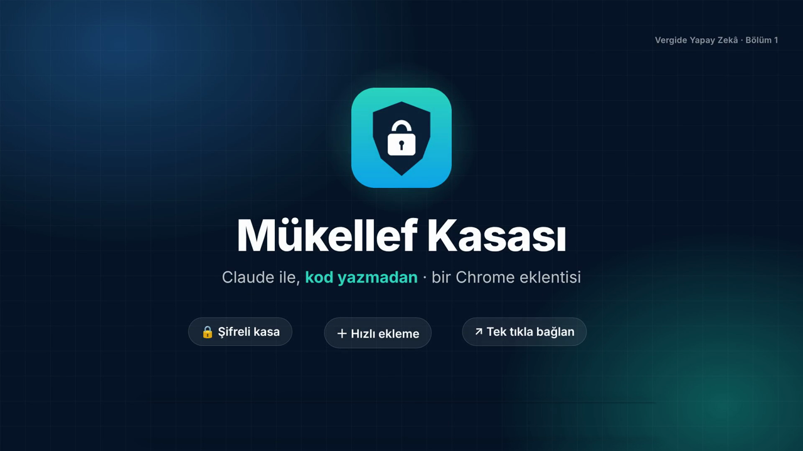
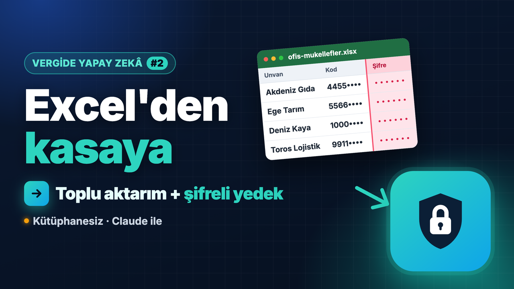
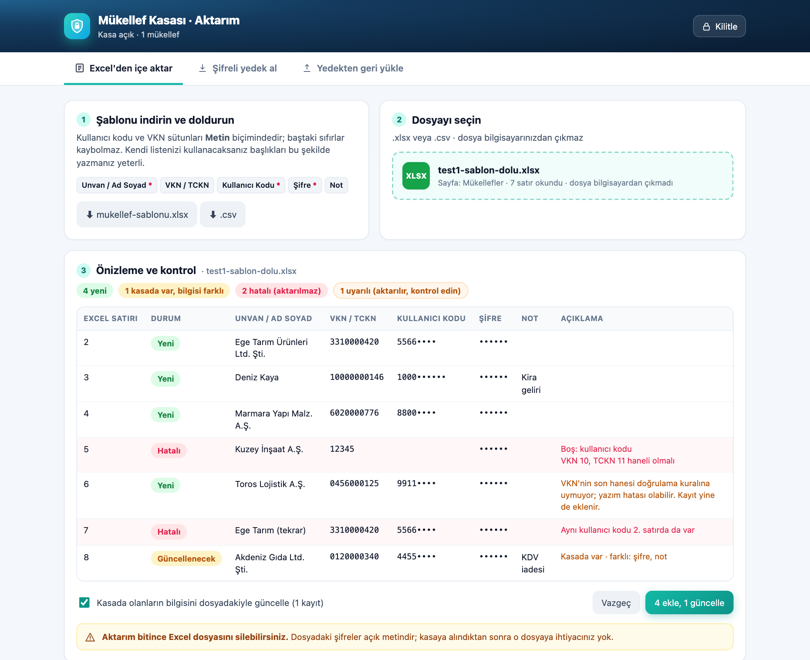

# Mükellef Kasası



Mükelleflerin **Dijital Vergi Dairesi** kullanıcı kodu ve şifrelerini, sizin belirlediğiniz bir **ana şifre** ile şifrelenmiş bir kasada saklayan Chrome eklentisi. **Bağlan** dediğinizde giriş sayfasını açar, kullanıcı kodu ve şifreyi yazar. **Güvenlik kodunu siz girip** girişi kendiniz yaparsınız.

## 🎥 Videoları izleyin

**Bölüm 1:** Eklentinin Claude ile nasıl üretildiğini, nasıl kurulduğunu ve kullanıldığını 2 dakikalık videoda adım adım gösteriyoruz.

[](https://www.youtube.com/watch?v=Vts7uFKumzI)

▶️ **https://www.youtube.com/watch?v=Vts7uFKumzI**

**Bölüm 2:** v1.1'deki yenilikler: Excel'den toplu aktarım, şifreli yedekle başka bilgisayara taşıma, kopyalama ve Kilitle butonları. Claude'dan önce plan ve maket istemeyi, harici kütüphane kullanmamanın nedenlerini de anlatıyoruz.

[](https://youtu.be/rT27P1dPThk)

▶️ **https://youtu.be/rT27P1dPThk**

## Neden yapıldı?

Bu depo, **Vergide Yapay Zekâ** video serisinin ilk iki bölümünün çıktısıdır. Serinin amacı, vergi alanında çalışanların yapay zekâyı daha etkin kullanması: işimizi kolaylaştıracak küçük araçları, kod yazmadan, yapay zekâya tarif ederek kendimiz üretebiliriz.

Birinci bölümde mükellef kasasını seçtik. Dijital Vergi Dairesi şifreleri çoğu ofiste hâlâ bir Excel dosyasında ya da benzer bir yerde, açık metin olarak duruyor ve her girişte elle yazılıyor. Bu eklenti aynı bilgileri şifreli bir kasada tutar ve girişi tek tıka indirir.

Eklentinin tüm kodu [Claude](https://claude.ai) ile, aşağıdaki istemle üretildi. Tüm süreci [videoda](https://www.youtube.com/watch?v=Vts7uFKumzI) izleyebilirsiniz; v1.1'deki geliştirmeler [Bölüm 2'de](https://youtu.be/rT27P1dPThk).

## Kurulum

Eklenti Chrome Web Mağazası'nda değildir; “paketlenmemiş eklenti” olarak yüklenir.

1. Bu sayfada **Code → Download ZIP** ile dosyaları indirin.
2. ZIP'i kalıcı bir klasöre çıkarın (ör. `Belgeler/MukellefKasasi`). Eklenti bu klasörden çalışır; klasörü silmeyin ya da taşımayın.
3. Chrome'da adres çubuğuna `chrome://extensions` yazın.
4. Sağ üstten **Geliştirici modu**nu açın.
5. **Paketlenmemiş öğe yükle**'ye basın ve içinde `manifest.json` bulunan klasörü seçin. GitHub'dan indirilen ZIP'te bu klasörün adı `mukellef-kasasi-main` olur.
6. Sağ üstteki **yapboz simgesine** tıklayın, **Mükellef Kasası**'nın yanındaki **raptiyeye** basarak eklentiyi araç çubuğuna sabitleyin.

## Kullanım


1. İlk açılışta ana şifrenizi oluşturun (en az 8 karakter). **Ana şifreyi unutursanız kasa açılamaz; kurtarma yoktur.**
2. **+ Ekle** ile mükellef ekleyin: unvan, VKN/TCKN (isteğe bağlı), kullanıcı kodu, şifre, not.
3. Listeden **Bağlan**'a basın. Giriş sayfası yeni sekmede açılır, bilgiler dolar ve imleç güvenlik kodu alanına gelir.
4. Güvenlik kodunu yazıp **Giriş Yap**'a basın.

Mükellefi arama kutusuna birkaç harf yazarak bulun ve **Enter**'a basın: ilk sonuca bağlanır (**↑ ↓** ile başka satır seçebilirsiniz). Satırdaki **⋮** menüsünden düzenleyebilir, kullanıcı kodunu ya da şifreyi kopyalayabilir veya silebilirsiniz. Sağ üstteki **Kilitle** butonu, 10 dakikalık süreyi beklemeden kasayı hemen kilitler.

## Excel'den toplu aktarım



1. Eklentide sağ üstteki **⇅ Aktar** butonuna basın. Aktarım sayfası yeni sekmede açılır.
2. **mukellef-sablonu.xlsx** şablonunu indirip doldurun. Sütunlar: **Unvan / Ad Soyad\***, VKN / TCKN, **Kullanıcı Kodu\***, **Şifre\***, Not. Hücreler *Metin* biçimindedir; baştaki sıfırlar kaybolmaz. Kendi Excel listenizi de kullanabilirsiniz: başlıkları bu şekilde yazmanız yeterli ("Ünvan", "Kullanıcı Adı", "Parola" gibi yakın başlıklar da tanınır). CSV (`;` ayırıcılı) da olur.
3. Dosyayı seçin ya da sürükleyip bırakın. Kasaya bir şey yazılmadan önce **önizleme** gelir:
   - **Yeni**: kasaya eklenecek.
   - **Güncellenecek**: aynı kullanıcı kodu kasada var ama bilgisi farklı. Yalnızca "güncelle" kutusunu işaretlerseniz dosyadaki bilgi yazılır.
   - **Aynı**: kasada aynen var, atlanır.
   - **Hatalı**: zorunlu alan boş, VKN/TCKN hane sayısı yanlış ya da aynı kullanıcı kodu dosyada iki kez geçiyor. Bu satırlar aktarılmaz.
   - VKN/TCKN'nin son haneleri resmî doğrulama kuralına uymuyorsa uyarı gösterilir; kayıt yine de aktarılır. Rastgele yazılmış numaralar bu yüzden uyarı verir.
   - Satır numaraları Excel'deki satır numaralarıdır (1. satır başlıktır).
4. **Kasaya ekle**'ye basın. Ardından Excel dosyasını **silebilirsiniz**: içindeki şifreler açık metindir.

Excel dosyası hiçbir yere gönderilmez ve harici kütüphane kullanılmadan okunur. `.xlsx` aslında bir ZIP arşividir; eklenti onu tarayıcının yerleşik `DecompressionStream` aracıyla açar, içindeki XML'i `DOMParser` ile okur (`spreadsheet.js`, yaklaşık 250 satır).

## Şifreli yedek ve başka bilgisayara taşıma

**Yedek almak:** **Aktar** → **Şifreli yedek al**. Ana şifrenizi doğrulayın ve dosyayı nasıl şifreleyeceğinizi seçin:

- **Ana şifremle şifrele** (önerilen): yeni bilgisayarda aynı ana şifreyi yazarsınız.
- **Bu yedek için ayrı bir şifre belirle**: dosyayı bir çalışma arkadaşınıza vereceğinizde; ana şifreniz paylaşılmaz.

İndirilen `mukellef-kasasi-yedek-YYYY-AA-GG.mkasa` dosyası AES-256-GCM ile şifrelidir. Şifre bilinmeden açılamaz; dosyada bir bayt bile değiştirilirse açılmaz.

**Geri yüklemek:** Diğer bilgisayarda eklentiyi kurun, **Aktar** → **Yedekten geri yükle** (kasa henüz yoksa ilk ekrandaki **Yedekten geri yükleyin** butonu). Dosyayı seçip şifresini yazın; önizleme Excel aktarımındakiyle aynıdır.

- Bilgisayarda kasa yoksa kasa oluşturulur ve **yedeğin şifresi yeni kasanın ana şifresi olur.**
- Kasa varsa kayıtlar **birleştirilir**: hiçbir kayıt silinmez, aynı kullanıcı kodlu kayıtlar yalnızca "güncelle" seçilirse değişir.

## Güvenlik

- **Şifreleme:** Ana şifreden PBKDF2-SHA256 (600.000 tur) ile türetilen anahtar ve AES-256-GCM. Yalnızca tarayıcının yerleşik Web Crypto API'si kullanılır, harici kütüphane yoktur.
- **Ana şifre hiçbir yerde saklanmaz.** Diskte yalnızca şifreli kasa durur (`chrome.storage.local`).
- Kilit açıkken anahtar yalnızca bellekte tutulur (`chrome.storage.session`). 10 dakika işlem yapılmazsa ya da tarayıcı kapanınca kasa kilitlenir.
- 5 hatalı ana şifre denemesinden sonra artan bir bekleme süresi uygulanır.
- **Eklenti internete veri göndermez.** Tek site izni `https://dijital.gib.gov.tr/*` adresidir. Excel aktarımı ve yedekleme için yeni izin istenmez.
- **Harici kütüphane yoktur.** Şifreleme, Excel okuma ve dosya indirme tarayıcının yerleşik araçlarıyla yapılır; denetlenecek kodun tamamı bu depodadır.
- Yedek almak için kilit açık olsa bile ana şifre yeniden sorulur. Yedek dosyası kendi rastgele tuzu ile PBKDF2-SHA256 (600.000 tur) + AES-256-GCM kullanır; dosya başlığı (tarih, kayıt sayısı, ayarlar) da doğrulanır.
- Giriş bilgisi yalnızca **Bağlan** ile açılan sekmeye, tek seferlik ve en fazla 60 saniyeliğine verilir.
- Eklenti **Giriş Yap** butonuna basmaz ve güvenlik kodunu çözmeye çalışmaz.
- Paylaşılan bilgisayarlarda işletim sistemi oturumunuzu kilitlemeyi unutmayın.

## Kullanılan istem

Videoda Claude'a verilen istem şöyleydi. Kendi ihtiyacınıza göre değiştirip benzer araçlar üretebilirsiniz:

```text
Dijital Vergi Dairesi için bir Chrome eklentisi (Manifest V3) yap. Adı: Mükellef Kasası.
1) İlk açılışta kullanıcı bir ana şifre belirlesin; kasa bu şifreyle kilitlensin.
2) "+ Ekle" ile mükellef eklensin: unvan, VKN/TCKN, kullanıcı kodu, şifre, not.
3) Her satırda "Bağlan" butonu olsun: dijital.gib.gov.tr/portal/login sayfasını açsın,
   kullanıcı kodu ve şifreyi yazsın, imleci güvenlik kodu alanına getirsin.

Güvenlik kuralları:
- Veriler AES-256-GCM ile şifrelensin; anahtar ana şifreden PBKDF2 ile türetilsin,
  ana şifre saklanmasın. Veriler yalnızca bu bilgisayarda dursun.
- Hiçbir sunucuya veri gönderilmesin, harici kütüphane kullanılmasın.
- Eklenti yalnızca dijital.gib.gov.tr için izin istesin.
- 10 dakika işlem yoksa kasa otomatik kilitlensin.
- Güvenlik kodunu çözmeye çalışma; "Giriş Yap"a basma.
```

### Bölüm 2'de kullanılan istemler (v1.1)

v1.1'deki üç iyileştirme için Claude'a şu istemler verildi. Her birinde önce plan ve görünüm konuşuldu, kod ondan sonra yazıldı:

```text
1) Tek mükellef varken ⋮ menüsü kesiliyor, ekran görüntüsü ekte. Kod yazmadan önce
   bana birkaç çözümü maketle göster. En sık yaptığım iş Bağlan; buna göre öner. Ayrıca:
   - ⋮ menüsüne "Kodu kopyala" ve "Şifreyi kopyala" ekle.
   - Sağ üste yazılı "Aktar" ve "Kilitle" butonları koy; Kilitle kasayı beklemeden kilitlesin.
   - Aramada Enter ilk sonuca bağlansın; ↑ ↓ oklarıyla sonuçlar arasında gezilebilsin.

2) Excel'den toplu aktarım ekle. Harici kütüphane kullanma. İndirilebilir bir şablon
   olsun. Kasaya yazmadan önce önizleme göster: zorunlu alanlar, VKN 10 / TCKN 11 hane,
   yinelenen kayıtlar. Şifreler ekranda görünmesin.

3) Kayıtları başka bilgisayara taşımak için şifreli bir yedek dosyası alınabilsin.
   Ana şifreyle ya da ayrı bir şifreyle şifrelensin. Geri yüklerken mevcut kayıtlar
   silinmesin.
```

## Dosyalar

| Dosya | Görevi |
| --- | --- |
| `manifest.json` | Eklenti tanımı ve izinler |
| `popup.html`, `popup.css`, `popup.js` | Kasa arayüzü: ana şifre, liste, ekleme ve düzenleme |
| `aktar.html`, `aktar.css`, `aktar.js` | Aktarım sayfası: Excel'den içe aktarma, şifreli yedek alma ve geri yükleme |
| `vault.js` | Kasa ve oturum işlemleri, kayıt kuralları (VKN/TCKN denetimi), birleştirme |
| `spreadsheet.js` | Kütüphanesiz `.xlsx` ve `.csv` okuyucu |
| `crypto.js` | Şifreleme yardımcıları (PBKDF2 + AES-GCM) |
| `background.js` | Bağlan'da giriş sayfasını açar, bilgiyi yalnızca o sekmeye bir kez verir |
| `content.js` | Giriş sayfasında kullanıcı kodu ve şifre alanlarını doldurur |
| `sablon/` | Excel (`.xlsx`) ve CSV aktarım şablonları |
| `icons/` | Eklenti simgeleri |

## Sırada ne var?

Excel'den toplu aktarım ve şifreli yedek v1.1.0 ile eklendi. Serinin sonraki bölümlerinde beyanname takibi ve KDV iadesi takibi var.

## Sürüm geçmişi

- **1.1.0** — Excel/CSV'den toplu aktarım (önizleme, doğrulama, yinelenen kayıt kontrolü), şifreli yedek alma ve başka bilgisayarda geri yükleme, daha sık liste satırları, kesilmeyen ⋮ menüsü, aramada Enter ile bağlanma, başlıkta yazılı **Aktar** ve **Kilitle** butonları, kodu ve şifreyi kopyalama, aynı kullanıcı kodunun iki kez eklenmesinin engellenmesi.
- **1.0.0** — İlk sürüm.

## Uyarı

Bu eklenti eğitim amaçlı bir örnektir ve Gelir İdaresi Başkanlığı ile resmî bir bağlantısı yoktur. Giriş sayfası `#userid`, `#sifre` ve `#dk` alanlarına göre doldurulur; sayfanın yapısı değişirse `content.js` dosyasının güncellenmesi gerekir. Kullanmadan önce kodu inceleyin ve ilk girişi kendi hesabınızla deneyin.

## Lisans

[MIT](LICENSE) © 2026 Eren Özdemir. Kodu serbestçe kullanabilir, değiştirebilir ve paylaşabilirsiniz; lisans metnini ve telif satırını korumanız yeterlidir. Yazılım garantisiz, “olduğu gibi” sunulur.
