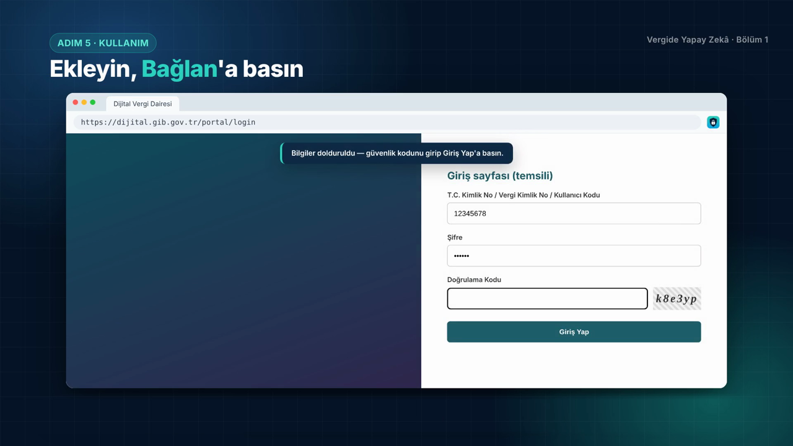

# Mükellef Kasası


Mükelleflerin **Dijital Vergi Dairesi** kullanıcı kodu ve şifrelerini, sizin belirlediğiniz bir **ana şifre** ile şifrelenmiş bir kasada saklayan Chrome eklentisi. **Bağlan** dediğinizde giriş sayfasını açar, kullanıcı kodu ve şifreyi yazar. **Güvenlik kodunu siz girip** girişi kendiniz yaparsınız.

## Neden yapıldı?

Bu depo, **Vergide Yapay Zekâ** video serisinin ilk bölümünün çıktısıdır. Serinin amacı, vergi alanında çalışanların yapay zekâyı daha etkin kullanması: işimizi kolaylaştıracak küçük araçları, kod yazmadan, yapay zekâya tarif ederek kendimiz üretebiliriz.

Birinci bölümde mükellef kasasını seçtik. Dijital Vergi Dairesi şifreleri çoğu ofiste hâlâ bir Excel dosyasında ya da benzer bir yerde, açık metin olarak duruyor ve her girişte elle yazılıyor. Bu eklenti aynı bilgileri şifreli bir kasada tutar ve girişi tek tıka indirir.

Eklentinin tüm kodu [Claude](https://claude.ai) ile, aşağıdaki istemle üretildi.

## Kurulum

Eklenti Chrome Web Mağazası'nda değildir; “paketlenmemiş eklenti” olarak yüklenir.

1. Bu sayfada **Code → Download ZIP** ile dosyaları indirin.
2. ZIP'i kalıcı bir klasöre çıkarın (ör. `Belgeler/MukellefKasasi`). Eklenti bu klasörden çalışır; klasörü silmeyin ya da taşımayın.
3. Chrome'da adres çubuğuna `chrome://extensions` yazın.
4. Sağ üstten **Geliştirici modu**nu açın.
5. **Paketlenmemiş öğe yükle**'ye basın ve içinde `manifest.json` bulunan klasörü seçin. GitHub'dan indirilen ZIP'te bu klasörün adı `mukellef-kasasi-main` olur.
6. Sağ üstteki **yapboz simgesine** tıklayın, **Mükellef Kasası**'nın yanındaki **raptiyeye** basarak eklentiyi araç çubuğuna sabitleyin.

## Kullanım



1. İlk açılışta ana şifrenizi oluşturun (en az 8 karakter). **Ana şifreyi unutursanız kasa açılamaz; kurtarma yoktur.**
2. **+ Ekle** ile mükellef ekleyin: unvan, VKN/TCKN (isteğe bağlı), kullanıcı kodu, şifre, not.
3. Listeden **Bağlan**'a basın. Giriş sayfası yeni sekmede açılır, bilgiler dolar ve imleç güvenlik kodu alanına gelir.
4. Güvenlik kodunu yazıp **Giriş Yap**'a basın.

Mükellefleri arama kutusuyla bulabilir, satırdaki **⋮** menüsünden düzenleyebilir ya da silebilirsiniz. 🔒 butonu kasayı anında kilitler.

## Güvenlik

- **Şifreleme:** Ana şifreden PBKDF2-SHA256 (600.000 tur) ile türetilen anahtar ve AES-256-GCM. Yalnızca tarayıcının yerleşik Web Crypto API'si kullanılır, harici kütüphane yoktur.
- **Ana şifre hiçbir yerde saklanmaz.** Diskte yalnızca şifreli kasa durur (`chrome.storage.local`).
- Kilit açıkken anahtar yalnızca bellekte tutulur (`chrome.storage.session`). 10 dakika işlem yapılmazsa ya da tarayıcı kapanınca kasa kilitlenir.
- 5 hatalı ana şifre denemesinden sonra artan bir bekleme süresi uygulanır.
- **Eklenti internete veri göndermez.** Tek site izni `https://dijital.gib.gov.tr/*` adresidir.
- Giriş bilgisi yalnızca **Bağlan** ile açılan sekmeye, tek seferlik ve en fazla 60 saniyeliğine verilir.
- Eklenti **Giriş Yap** butonuna basmaz ve güvenlik kodunu çözmeye çalışmaz.
- Paylaşılan bilgisayarlarda işletim sistemi oturumunuzu kilitlemeyi unutmayın.

## Kullanılan istem

Videoda Claude'a verilen istem şöyleydi. Kendi ihtiyacınıza göre değiştirip benzer araçlar üretebilirsiniz:

```text
Dijital Vergi Dairesi için bir Chrome eklentisi (Manifest V3) yap. Adı: Mükellef Kasası.
1) İlk açılışta kullanıcı bir ana şifre belirlesin; kasa bu şifreyle kilitlensin.
2) "+ Ekle" ile mükellef eklensin: unvan, VKN/TCKN, kullanıcı kodu, şifre, not.
3) Her satırda "Bağlan" butonu olsun: dijital.gib.gov.tr/portal/login sayfasını açsın,
   kullanıcı kodu ve şifreyi yazsın, imleci güvenlik kodu alanına getirsin.

Güvenlik kuralları:
- Veriler AES-256-GCM ile şifrelensin; anahtar ana şifreden PBKDF2 ile türetilsin,
  ana şifre saklanmasın. Veriler yalnızca bu bilgisayarda dursun.
- Hiçbir sunucuya veri gönderilmesin, harici kütüphane kullanılmasın.
- Eklenti yalnızca dijital.gib.gov.tr için izin istesin.
- 10 dakika işlem yoksa kasa otomatik kilitlensin.
- Güvenlik kodunu çözmeye çalışma; "Giriş Yap"a basma.
```

## Dosyalar

| Dosya | Görevi |
| --- | --- |
| `manifest.json` | Eklenti tanımı ve izinler |
| `popup.html`, `popup.css`, `popup.js` | Kasa arayüzü: ana şifre, liste, ekleme ve düzenleme |
| `crypto.js` | Şifreleme yardımcıları (PBKDF2 + AES-GCM) |
| `background.js` | Bağlan'da giriş sayfasını açar, bilgiyi yalnızca o sekmeye bir kez verir |
| `content.js` | Giriş sayfasında kullanıcı kodu ve şifre alanlarını doldurur |
| `icons/` | Eklenti simgeleri |

## Sırada ne var?

Serinin sonraki bölümlerinde Excel'den toplu aktarım, beyanname takibi ve KDV iadesi takibi eklenecek.

## Uyarı

Bu eklenti eğitim amaçlı bir örnektir ve Gelir İdaresi Başkanlığı ile resmî bir bağlantısı yoktur. Giriş sayfası `#userid`, `#sifre` ve `#dk` alanlarına göre doldurulur; sayfanın yapısı değişirse `content.js` dosyasının güncellenmesi gerekir. Kullanmadan önce kodu inceleyin ve ilk girişi kendi hesabınızla deneyin.
