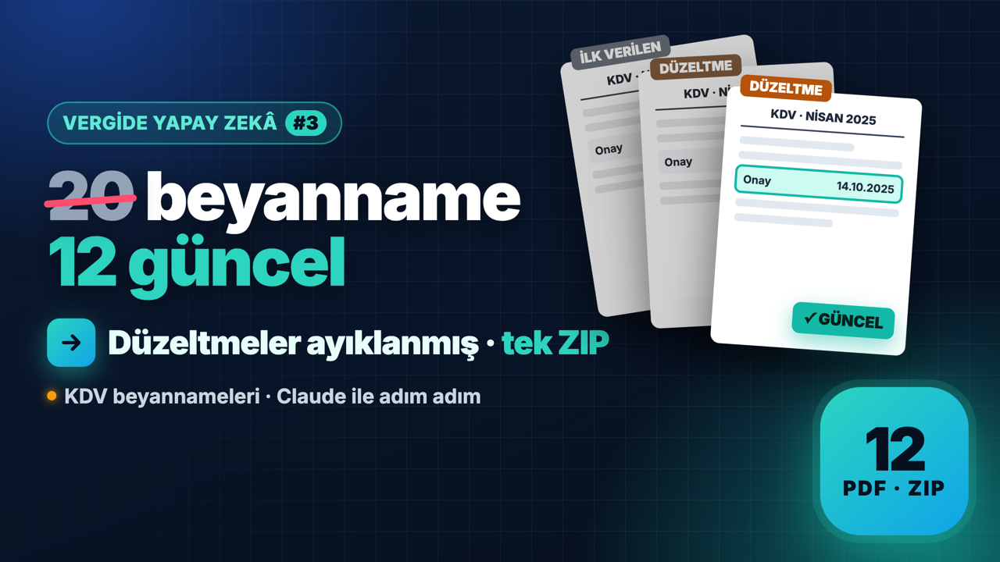
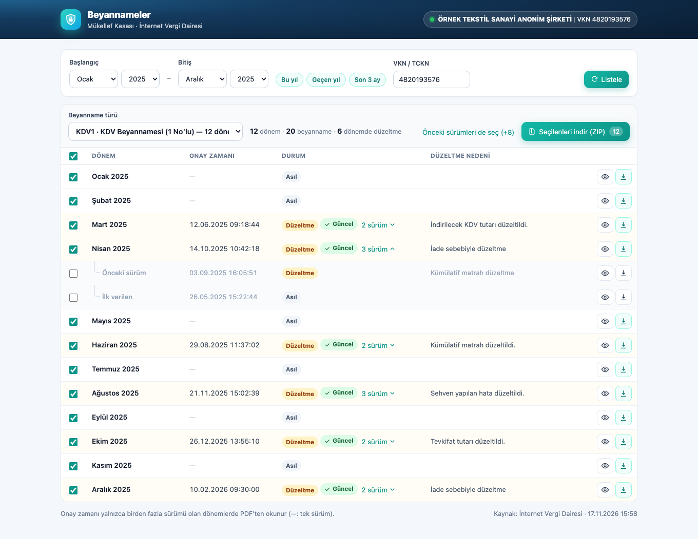

# Mükellef Kasası


Mükelleflerin **Dijital Vergi Dairesi** kullanıcı kodu ve şifrelerini, sizin belirlediğiniz bir **ana şifre** ile şifrelenmiş bir kasada saklayan Chrome eklentisi. **Bağlan** dediğinizde giriş sayfasını açar, kullanıcı kodu ve şifreyi yazar. **Güvenlik kodunu siz girip** girişi kendiniz yaparsınız.

## 🎥 Videoları izleyin

**Bölüm 1:** Eklentinin Claude ile nasıl üretildiğini, nasıl kurulduğunu ve kullanıldığını 2 dakikalık videoda adım adım gösteriyoruz.

[](https://www.youtube.com/watch?v=Vts7uFKumzI)

▶️ **https://www.youtube.com/watch?v=Vts7uFKumzI**

**Bölüm 2:** v1.1'deki yenilikler: Excel'den toplu aktarım, şifreli yedekle başka bilgisayara taşıma, kopyalama ve Kilitle butonları. Claude'dan önce plan ve maket istemeyi, harici kütüphane kullanmamanın nedenlerini de anlatıyoruz.

[](https://youtu.be/rT27P1dPThk)

▶️ **https://youtu.be/rT27P1dPThk**

**Bölüm 3:** v1.2 ile beyanname takibi: İnternet Vergi Dairesi'nde beyannameleri listeleme, düzeltmelerde PDF'teki onay zamanına göre güncel sürümü seçme ve seçilenleri tek ZIP olarak indirme. Bu bölümde sonuçtan çok yolu gösteriyoruz: siteyi Geliştirici Araçları ile incelemek, istemleri neden böyle yazdığımız, maket, test ve gerçek denemede çıkan sorunlar. Eklentiyi kayıtları kaybetmeden güncellemeyi de anlatıyoruz.

[](https://www.youtube.com/watch?v=SKAnJJIFzL8)

▶️ **https://www.youtube.com/watch?v=SKAnJJIFzL8**

## Neden yapıldı?

Bu depo, **Vergide Yapay Zekâ** video serisinin ilk üç bölümünün çıktısıdır; eklenti her bölümde yeni bir özellikle büyüyor. Serinin amacı, vergi alanında çalışanların yapay zekâyı daha etkin kullanması: işimizi kolaylaştıracak küçük araçları, kod yazmadan, yapay zekâya tarif ederek kendimiz üretebiliriz.

Birinci bölümde mükellef kasasını seçtik. Dijital Vergi Dairesi şifreleri çoğu ofiste hâlâ bir Excel dosyasında ya da benzer bir yerde, açık metin olarak duruyor ve her girişte elle yazılıyor. Bu eklenti aynı bilgileri şifreli bir kasada tutar ve girişi tek tıka indirir.

Eklentinin tüm kodu [Claude](https://claude.ai) ile, aşağıdaki istemle üretildi. Tüm süreci [videoda](https://www.youtube.com/watch?v=Vts7uFKumzI) izleyebilirsiniz; v1.1'deki geliştirmeler [Bölüm 2'de](https://youtu.be/rT27P1dPThk), v1.2'deki beyanname takibi ve bu özelliği adım adım nasıl geliştirdiğimiz [Bölüm 3'te](https://www.youtube.com/watch?v=SKAnJJIFzL8).

## Kurulum

Eklenti Chrome Web Mağazası'nda değildir; “paketlenmemiş eklenti” olarak yüklenir.

1. Bu sayfada **Code → Download ZIP** ile dosyaları indirin.
2. ZIP'i kalıcı bir klasöre çıkarın (ör. `Belgeler/MukellefKasasi`). Eklenti bu klasörden çalışır; klasörü silmeyin ya da taşımayın.
3. Chrome'da adres çubuğuna `chrome://extensions` yazın.
4. Sağ üstten **Geliştirici modu**nu açın.
5. **Paketlenmemiş öğe yükle**'ye basın ve içinde `manifest.json` bulunan klasörü seçin. GitHub'dan indirilen ZIP'te bu klasörün adı `mukellef-kasasi-main` olur.
6. Sağ üstteki **yapboz simgesine** tıklayın, **Mükellef Kasası**'nın yanındaki **raptiyeye** basarak eklentiyi araç çubuğuna sabitleyin.

## Eklentiyi güncelleme

Eklentiyi daha önce kurduysanız yeni sürüme geçerken kasadaki kayıtlarınız korunur. Tek koşul: yeni dosyaları **eklentiyi ilk kurduğunuz klasöre** koymak.

1. **Önce yedek alın:** **Aktar** → **Şifreli yedek al**. Bir şey ters giderse kayıtlarınızı bu dosyadan geri yüklersiniz.
2. Bu sayfada **Code → Download ZIP** ile yeni sürümü indirin ve ZIP'i açın.
3. Açılan `mukellef-kasasi-main` klasörünün **içindeki dosyaları** seçin ve eklentiyi ilk kurduğunuz klasöre kopyalayın (ör. `Belgeler/MukellefKasasi`). Aynı adlı dosyalar için **Değiştir**'i seçin.
4. Chrome'da `chrome://extensions` sayfasını açın ve **Mükellef Kasası** kartındaki **↻ (yeniden yükle)** düğmesine basın.
5. Kartta sürüm **1.2.0** görünüyorsa güncelleme tamam. **Ayrıntılar** → **Site erişimi**'nde eklentinin yalnızca iki GİB adresine erişebildiğini görebilirsiniz.

> ⚠️ **Başka bir klasöre çıkarmayın.** Yeni dosyaları farklı bir klasöre çıkarıp **Paketlenmemiş öğe yükle** ile oradan yüklerseniz Chrome bunu yeni bir eklenti sayar ve kasanız boş görünür. Kayıtlarınız eski eklentide durur; **eski eklentiyi kaldırmayın**, kaldırırsanız kasası da silinir. Böyle olduysa yeni kopyayı kaldırıp yukarıdaki adımları izleyin ya da 1. adımda aldığınız yedeği yeni kopyada **Aktar** → **Yedekten geri yükle** ile açın.

## Kullanım


1. İlk açılışta ana şifrenizi oluşturun (en az 8 karakter). **Ana şifreyi unutursanız kasa açılamaz; kurtarma yoktur.**
2. **+ Ekle** ile mükellef ekleyin: unvan, VKN/TCKN (isteğe bağlı), kullanıcı kodu, şifre, not.
3. Listeden **Bağlan**'a basın. Giriş sayfası yeni sekmede açılır, bilgiler dolar ve imleç güvenlik kodu alanına gelir.
4. Güvenlik kodunu yazıp **Giriş Yap**'a basın.

Mükellefi arama kutusuna birkaç harf yazarak bulun ve **Enter**'a basın: ilk sonuca bağlanır (**↑ ↓** ile başka satır seçebilirsiniz). Satırdaki **⋮** menüsünden düzenleyebilir, kullanıcı kodunu ya da şifreyi kopyalayabilir veya silebilirsiniz. Sağ üstteki **Kilitle** butonu, 10 dakikalık süreyi beklemeden kasayı hemen kilitler.

## Excel'den toplu aktarım


1. Eklentide sağ üstteki **⇅ Aktar** butonuna basın. Aktarım sayfası yeni sekmede açılır.
2. **mukellef-sablonu.xlsx** şablonunu indirip doldurun. Sütunlar: **Unvan / Ad Soyad\***, VKN / TCKN, **Kullanıcı Kodu\***, **Şifre\***, Not. Hücreler *Metin* biçimindedir; baştaki sıfırlar kaybolmaz. Kendi Excel listenizi de kullanabilirsiniz: başlıkları bu şekilde yazmanız yeterli ("Ünvan", "Kullanıcı Adı", "Parola" gibi yakın başlıklar da tanınır). CSV (`;` ayırıcılı) da olur.
3. Dosyayı seçin ya da sürükleyip bırakın. Kasaya bir şey yazılmadan önce **önizleme** gelir:
   - **Yeni**: kasaya eklenecek.
   - **Güncellenecek**: aynı kullanıcı kodu kasada var ama bilgisi farklı. Yalnızca "güncelle" kutusunu işaretlerseniz dosyadaki bilgi yazılır.
   - **Aynı**: kasada aynen var, atlanır.
   - **Hatalı**: zorunlu alan boş, VKN/TCKN hane sayısı yanlış ya da aynı kullanıcı kodu dosyada iki kez geçiyor. Bu satırlar aktarılmaz.
   - VKN/TCKN'nin son haneleri resmî doğrulama kuralına uymuyorsa uyarı gösterilir; kayıt yine de aktarılır. Rastgele yazılmış numaralar bu yüzden uyarı verir.
   - Satır numaraları Excel'deki satır numaralarıdır (1. satır başlıktır).
4. **Kasaya ekle**'ye basın. Ardından Excel dosyasını **silebilirsiniz**: içindeki şifreler açık metindir.

Excel dosyası hiçbir yere gönderilmez ve harici kütüphane kullanılmadan okunur. `.xlsx` aslında bir ZIP arşividir; eklenti onu tarayıcının yerleşik `DecompressionStream` aracıyla açar, içindeki XML'i `DOMParser` ile okur (`spreadsheet.js`, yaklaşık 250 satır).

## Şifreli yedek ve başka bilgisayara taşıma

**Yedek almak:** **Aktar** → **Şifreli yedek al**. Ana şifrenizi doğrulayın ve dosyayı nasıl şifreleyeceğinizi seçin:

- **Ana şifremle şifrele** (önerilen): yeni bilgisayarda aynı ana şifreyi yazarsınız.
- **Bu yedek için ayrı bir şifre belirle**: dosyayı bir çalışma arkadaşınıza vereceğinizde; ana şifreniz paylaşılmaz.

İndirilen `mukellef-kasasi-yedek-YYYY-AA-GG.mkasa` dosyası AES-256-GCM ile şifrelidir. Şifre bilinmeden açılamaz; dosyada bir bayt bile değiştirilirse açılmaz.

**Geri yüklemek:** Diğer bilgisayarda eklentiyi kurun, **Aktar** → **Yedekten geri yükle** (kasa henüz yoksa ilk ekrandaki **Yedekten geri yükleyin** butonu). Dosyayı seçip şifresini yazın; önizleme Excel aktarımındakiyle aynıdır.

- Bilgisayarda kasa yoksa kasa oluşturulur ve **yedeğin şifresi yeni kasanın ana şifresi olur.**
- Kasa varsa kayıtlar **birleştirilir**: hiçbir kayıt silinmez, aynı kullanıcı kodlu kayıtlar yalnızca "güncelle" seçilirse değişir.

## Beyanname takibi (İnternet Vergi Dairesi)



1. Dijital Vergi Dairesi'ne giriş yapın ve ana sayfadaki **İnternet Vergi Dairesi** kartına tıklayıp yönlendirmeyi onaylayın. IVD yeni sekmede açılır.
2. IVD sekmesindeyken eklenti simgesine basın. Popup sayfayı tanır ve **IVD işlemleri**ni gösterir; kasa kilidini açmanız gerekmez.
3. **Beyannameler**'e basın. Beyanname sayfası yeni sekmede açılır.
4. Başlangıç ve bitiş dönemini seçip **Listele**'ye basın (*Bu yıl*, *Geçen yıl*, *Son 3 ay* kısayolları var). IVD tek sorguda en fazla bir yıl kabul ettiği için daha uzun aralıklar yıllara bölünerek sorgulanır.
   IVD sekmesi kapanır ya da oturum düşerse sayfa açık kalır: IVD'yi yeniden açtığınızda sayfa açık IVD sekmesini kendisi bulur ve liste kaldığı yerden devam eder. Sayfayı yenilediğinizde de bağlantı kendiliğinden kurulur.
5. **Beyanname türü** kutusundan türü seçin. KDV1, KDV2, KGECICI, KURUMLAR, GELIR ve GGECICI her zaman üstte durur; o dönemde kaydı olmayanlar soluk görünür. Altında sorguda gelen diğer türler listelenir. Son seçtiğiniz tür hatırlanır.
6. Her satırda **Görüntüle** (PDF yeni sekmede açılır) ve **İndir** düğmeleri var.
7. **Seçilenleri indir (ZIP)** seçili türün işaretli satırlarını tek ZIP olarak indirir. ZIP'te PDF'lerin yanında Excel'de açılan bir `ozet.csv` de bulunur. Dosya adları: `<VKN>_<TÜR>_<dönem>.pdf`, ZIP adı: `<VKN>_<TÜR>_<başlangıç>_<bitiş>.zip`.

**Düzeltme beyannameleri:** Aynı dönem için birden fazla beyanname verildiyse eklenti her sürümün PDF'indeki **Onay Zamanı**'nı okur ve en yenisini **Güncel** olarak işaretler. Liste açıldığında her dönemin yalnızca güncel sürümü seçili gelir; örneğin bir yılda 8 düzeltmeyle 20 KDV beyannamesi varsa ZIP'e 12 güncel beyanname girer. Önceki sürümleri tek tek ya da **Önceki sürümleri de seç** ile ekleyebilirsiniz (`…_onceki-1.pdf`). Bir PDF'te onay zamanı okunamazsa satır **Tahmini** olarak işaretlenir ve o dönemin tüm sürümleri ZIP'e eklenir; eklenti sessizce tahmin yapmaz.

## Güvenlik

- **Şifreleme:** Ana şifreden PBKDF2-SHA256 (600.000 tur) ile türetilen anahtar ve AES-256-GCM. Yalnızca tarayıcının yerleşik Web Crypto API'si kullanılır, harici kütüphane yoktur.
- **Ana şifre hiçbir yerde saklanmaz.** Diskte yalnızca şifreli kasa durur (`chrome.storage.local`).
- Kilit açıkken anahtar yalnızca bellekte tutulur (`chrome.storage.session`). 10 dakika işlem yapılmazsa ya da tarayıcı kapanınca kasa kilitlenir.
- 5 hatalı ana şifre denemesinden sonra artan bir bekleme süresi uygulanır.
- **Eklenti internete veri göndermez.** Yalnızca iki GİB adresine erişebilir: `https://dijital.gib.gov.tr/*` (giriş sayfası) ve v1.2'den itibaren `https://intvrg.gib.gov.tr/*` (İnternet Vergi Dairesi). Excel aktarımı ve yedekleme için izin istenmez.
- **Beyanname takibi (v1.2) için** `intvrg.gib.gov.tr` site izni ve `scripting` izni eklendi. IVD sayfasına kendiliğinden çalışan bir betik konmaz: `ivd.js` yalnızca siz popup'ı ya da beyanname sayfasını açtığınızda IVD sekmesine yüklenir.
- IVD oturum anahtarı (adres çubuğundaki `token`) **IVD sekmesinden çıkmaz**: hiçbir yere yazılmaz, beyanname sayfası onu görmez. İstekler IVD sekmesindeki `ivd.js` üzerinden, sitenin kendi adresinden gider.
- `ivd.js` yalnızca okuma yapar: oturumun kime ait olduğu (IVD'nin kendi açılışta yaptığı oturum bilgisi sorgusu; yanıttan yalnızca VKN/TCKN ve unvan alınır), beyanname listesi ve beyanname PDF'i. Beyanname gönderme, iptal gibi hiçbir işleme dokunmaz. Yönlendirme onayına ve IVD kartına eklenti değil, siz basarsınız.
- PDF'ler sırayla ve kısa aralıklarla istenir. Okunan PDF'ler yalnızca sayfa açıkken bellekte tutulur.
- **Harici kütüphane yoktur.** Şifreleme, Excel okuma ve dosya indirme tarayıcının yerleşik araçlarıyla yapılır; denetlenecek kodun tamamı bu depodadır.
- Yedek almak için kilit açık olsa bile ana şifre yeniden sorulur. Yedek dosyası kendi rastgele tuzu ile PBKDF2-SHA256 (600.000 tur) + AES-256-GCM kullanır; dosya başlığı (tarih, kayıt sayısı, ayarlar) da doğrulanır.
- Giriş bilgisi yalnızca **Bağlan** ile açılan sekmeye, tek seferlik ve en fazla 60 saniyeliğine verilir.
- Eklenti **Giriş Yap** butonuna basmaz ve güvenlik kodunu çözmeye çalışmaz.
- Paylaşılan bilgisayarlarda işletim sistemi oturumunuzu kilitlemeyi unutmayın.

## Kullanılan istem

Videoda Claude'a verilen istem şöyleydi. Kendi ihtiyacınıza göre değiştirip benzer araçlar üretebilirsiniz:

```text
Dijital Vergi Dairesi için bir Chrome eklentisi (Manifest V3) yap. Adı: Mükellef Kasası.
1) İlk açılışta kullanıcı bir ana şifre belirlesin; kasa bu şifreyle kilitlensin.
2) "+ Ekle" ile mükellef eklensin: unvan, VKN/TCKN, kullanıcı kodu, şifre, not.
3) Her satırda "Bağlan" butonu olsun: dijital.gib.gov.tr/portal/login sayfasını açsın,
   kullanıcı kodu ve şifreyi yazsın, imleci güvenlik kodu alanına getirsin.

Güvenlik kuralları:
- Veriler AES-256-GCM ile şifrelensin; anahtar ana şifreden PBKDF2 ile türetilsin,
  ana şifre saklanmasın. Veriler yalnızca bu bilgisayarda dursun.
- Hiçbir sunucuya veri gönderilmesin, harici kütüphane kullanılmasın.
- Eklenti yalnızca dijital.gib.gov.tr için izin istesin.
- 10 dakika işlem yoksa kasa otomatik kilitlensin.
- Güvenlik kodunu çözmeye çalışma; "Giriş Yap"a basma.
```

### Bölüm 2'de kullanılan istemler (v1.1)

v1.1'deki üç iyileştirme için Claude'a şu istemler verildi. Her birinde önce plan ve görünüm konuşuldu, kod ondan sonra yazıldı:

```text
1) Tek mükellef varken ⋮ menüsü kesiliyor, ekran görüntüsü ekte. Kod yazmadan önce
   bana birkaç çözümü maketle göster. En sık yaptığım iş Bağlan; buna göre öner. Ayrıca:
   - ⋮ menüsüne "Kodu kopyala" ve "Şifreyi kopyala" ekle.
   - Sağ üste yazılı "Aktar" ve "Kilitle" butonları koy; Kilitle kasayı beklemeden kilitlesin.
   - Aramada Enter ilk sonuca bağlansın; ↑ ↓ oklarıyla sonuçlar arasında gezilebilsin.

2) Excel'den toplu aktarım ekle. Harici kütüphane kullanma. İndirilebilir bir şablon
   olsun. Kasaya yazmadan önce önizleme göster: zorunlu alanlar, VKN 10 / TCKN 11 hane,
   yinelenen kayıtlar. Şifreler ekranda görünmesin.

3) Kayıtları başka bilgisayara taşımak için şifreli bir yedek dosyası alınabilsin.
   Ana şifreyle ya da ayrı bir şifreyle şifrelensin. Geri yüklerken mevcut kayıtlar
   silinmesin.
```

### Bölüm 3'te kullanılan istemler (v1.2)

Bu bölümde istemlerden önce **araştırma** yaptık: işi elle bir kez yapıp tarayıcının Geliştirici Araçları'ndaki **Network** sekmesinden sitenin hangi istekleri gönderdiğini kaydettik ve bu kaydı Claude'a verdik. Aşağıdaki istemler sadeleştirilmiştir; eklediğimiz istek, yanıt ve PDF örnekleri burada yer almaz. **Kendi kaydınızı bir yapay zekâ aracına verirken adresteki oturum anahtarını çıkarın: oturum açıkken şifreniz gibidir.**

```text
1) Keşif ve amaç
Mükellef Kasası'na beyanname takibi ekleyelim. Akış şöyle: Dijital Vergi Dairesi'ne
girdikten sonra ana sayfadaki İnternet Vergi Dairesi kartına tıklanıyor (kartın HTML
öğesini ekledim). Onay penceresinden sonra İnternet Vergi Dairesi yeni sekmede açılıyor;
adresteki oturum anahtarıyla bir süre sorgu atılabiliyor. Beyanname sorgulama isteğini
ve yanıtını ayrı bir dosyada verdim. Amacımız: seçtiğim yıl ve ay aralığında beyanname
listesini türe göre çekmek, her birine Görüntüle ve İndir düğmesi koymak.
Kod yazmadan önce bir plan çıkar.

2) Yapı önerisi ve asıl dert
İnternet Vergi Dairesi sayfası açıkken eklentiye basınca eklenti sayfayı tanısın ve
yapılacak işler listesi çıksın. Beyanname'ye tıklayınca sorgulama, listeleme ve indirme
görünsün. "Tümünü indir (ZIP)" de olsun. Ama kullanıcıların zorlandığı bir durum var:
düzeltme beyannameleri. Aynı ay için üç beyanname olabilir: biri asıl, ikisi düzeltme.
Biz onay zamanı en yeni olanı almalıyız. Bunu çözmemiz gerekiyor.

3) Veriyle doğrulama
Düzeltme olan bir yanıt örneği ve düzeltme beyannamesinin PDF linki ekte. PDF'te
"Onay Zamanı" ve "Düzeltme Nedeni" yazıyor. Aynı dönemin asıl ve düzeltme PDF'lerini de
ekledim. Bazı türler yeni PDF biçimine geçti; o örneği de gönderiyorum, orada da
"Onay Zamanı" yazıyor.

4) Ekran kararı
Bunu açılır pencerede mi yapalım, yoksa Aktarım'daki gibi ayrı bir sayfada mı gösterelim?

5) Maket geri bildirimi
Popup için A uygun; "Yakında" satırı görünmesin. Tablo uygun, ama türler alt alta değil,
bir seçim kutusundan seçilsin. Sık kullanılanlar üstte olsun: KDV1, KDV2, KGECICI,
KURUMLAR, GELIR, GGECICI. "Tümünü indir" bütün beyannameleri değil, seçtiğimiz türü
indirsin; satırlarda seçim kutusu da olsun. En sık iş, KDV beyannamelerinin güncel
sürümlerini indirmek: örneğin 2025'te 20 beyanname var, 8'i düzeltme; kullanıcı güncel
12'sini istiyor. Darboğaz bu.

6) Gerçek deneme geri bildirimleri
- Denedim, VKN bulunamıyor, elle girmek zorunda kalıyoruz. Oturum bilgisini döndüren
  isteği ekte gönderiyorum.
- Beyanname sayfasını yenileyince bağlantı kurulamıyor. Açık olan İnternet Vergi Dairesi
  sekmesini arayarak bağlanamaz mı? Aynı tarayıcıda tek oturum açılabiliyor.
- İzin şart mı, yoksa eklentiyi yeniden kurmamak için mi böyle yazdık?
```

Bu istemlerde dikkat ettiğimiz dört şey: **akışı adım adım anlatmak**, **kendi kaydettiğimiz gerçek veriyi vermek** (Claude tahmin etmek zorunda kalmasın), **amacı ve asıl derdi somut yazmak** (20 beyanname, 8 düzeltme, güncel 12) ve **kod yazmadan önce plan ve maket istemek**. Claude'un bulduğu bir ipucu (beyanname kimliğindeki zaman damgası) PDF'lerle karşılaştırınca onay anı değil oluşturma anı çıktı; bu yüzden onay zamanı tahmin edilmiyor, PDF'ten okunuyor.

## Dosyalar

| Dosya | Görevi |
| --- | --- |
| `manifest.json` | Eklenti tanımı ve izinler |
| `popup.html`, `popup.css`, `popup.js` | Kasa arayüzü: ana şifre, liste, ekleme ve düzenleme |
| `aktar.html`, `aktar.css`, `aktar.js` | Aktarım sayfası: Excel'den içe aktarma, şifreli yedek alma ve geri yükleme |
| `vault.js` | Kasa ve oturum işlemleri, kayıt kuralları (VKN/TCKN denetimi), birleştirme |
| `spreadsheet.js` | Kütüphanesiz `.xlsx` ve `.csv` okuyucu |
| `crypto.js` | Şifreleme yardımcıları (PBKDF2 + AES-GCM) |
| `beyanname.html`, `beyanname.css`, `beyanname.js` | Beyanname sayfası: dönem, tür seçimi, liste, görüntüleme, seçilenleri indirme |
| `popup-ivd.js` | Popup'ta IVD sekmesini tanır, `ivd.js`'i yükler, IVD işlemleri ekranını gösterir |
| `ivd.js` | IVD sekmesinde çalışır: kimlik bilgisi, beyanname sorgusu ve PDF alma (token bu sekmeden çıkmaz) |
| `beyanname-kural.js` | Dönem ve tür adları, gruplama, güncel sürüm seçimi, dosya adları, CSV |
| `pdfmetin.js` | Kütüphanesiz PDF metin okuyucu: beyannamedeki "Onay Zamanı"nı bulur (GİB'in eski ve yeni PDF biçimleri) |
| `zipwrite.js` | Kütüphanesiz ZIP yazıcı (CRC-32, Türkçe dosya adları) |
| `background.js` | Bağlan'da giriş sayfasını açar, bilgiyi yalnızca o sekmeye bir kez verir |
| `content.js` | Giriş sayfasında kullanıcı kodu ve şifre alanlarını doldurur |
| `sablon/` | Excel (`.xlsx`) ve CSV aktarım şablonları |
| `icons/` | Eklenti simgeleri |

## Sırada ne var?

Beyanname takibi v1.2.0 ile eklendi. Sırada KDV iadesi takibi var.

## Sürüm geçmişi

- **1.2.0** — Beyanname takibi: IVD sekmesinde popup'ta IVD işlemleri, beyanname sayfası (dönem seçimi, tür seçim kutusu, görüntüleme ve indirme), düzeltme beyannamelerinde PDF'teki onay zamanına göre güncel sürüm, seçilenleri ZIP olarak indirme ve `ozet.csv`. Yeni izinler: `intvrg.gib.gov.tr` site izni, `scripting`.
- **1.1.0** — Excel/CSV'den toplu aktarım (önizleme, doğrulama, yinelenen kayıt kontrolü), şifreli yedek alma ve başka bilgisayarda geri yükleme, daha sık liste satırları, kesilmeyen ⋮ menüsü, aramada Enter ile bağlanma, başlıkta yazılı **Aktar** ve **Kilitle** butonları, kodu ve şifreyi kopyalama, aynı kullanıcı kodunun iki kez eklenmesinin engellenmesi.
- **1.0.0** — İlk sürüm.

## Uyarı

Bu eklenti eğitim amaçlı bir örnektir ve Gelir İdaresi Başkanlığı ile resmî bir bağlantısı yoktur. Eklenti bir robot ya da arka planda kendi başına çalışan bir otomasyon değildir: güvenlik kodunu çözmeye çalışmaz, hiçbir korumayı aşmaz; yalnızca sizin açtığınız oturumda, sizin başlattığınız işlemleri yapar. Sitelerin kullanım koşulları otomatik erişimi kısıtlayabilir. Bu eklentiyi kullanmak ya da benzer bir aracı kendiniz geliştirmek sizin kararınız ve sorumluluğunuzdadır; ilgili sitenin kullanım koşullarını okuyup bilinçli karar verin. Site ileride değişirse eklenti çalışmayabilir; site aynı işi kendisi sunmaya başlarsa eklentiye gerek de kalmayabilir. Giriş sayfası `#userid`, `#sifre` ve `#dk` alanlarına göre doldurulur; sayfanın yapısı değişirse `content.js` dosyasının güncellenmesi gerekir. Kullanmadan önce kodu inceleyin ve ilk girişi kendi hesabınızla deneyin.

## Lisans

[MIT](LICENSE) © 2026 Eren Özdemir. Kodu serbestçe kullanabilir, değiştirebilir ve paylaşabilirsiniz; lisans metnini ve telif satırını korumanız yeterlidir. Yazılım garantisiz, “olduğu gibi” sunulur.
